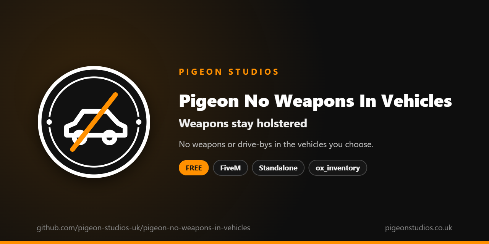

<div align="center">
  

  <h1>Pigeon No Weapons In Vehicles</h1>

  <p><strong>Keeps weapons holstered in the vehicles you choose, such as police helicopters or buses.</strong></p>

  <p>
    <a href="https://github.com/pigeon-studios-uk/pigeon-no-weapons-in-vehicles/releases/latest"></a>
    <a href="LICENSE.md"></a>
    <a href="https://discord.gg/2NFVWEUmDF"></a>
    
  </p>

  <p>
    <a href="https://github.com/pigeon-studios-uk/pigeon-no-weapons-in-vehicles/releases/latest"><strong>Download</strong></a> ·
    <a href="#installation">Install</a> ·
    <a href="#choosing-vehicles">Choose vehicles</a> ·
    <a href="CHANGELOG.md">Changelog</a> ·
    <a href="https://discord.gg/2NFVWEUmDF">Support</a>
  </p>
</div>

---

## Contents

- [Overview](#overview)
- [Features](#features)
- [What players see](#what-players-see)
- [Requirements](#requirements)
- [Installation](#installation)
- [Updating](#updating)
- [Choosing vehicles](#choosing-vehicles)
- [Configuration](#configuration)
- [Localisation](#localisation)
- [How it works](#how-it-works)
- [Update checker](#update-checker)
- [Performance](#performance)
- [Security](#security)
- [Troubleshooting](#troubleshooting)
- [FAQ](#faq)
- [Support](#support)
- [Contributing](#contributing)
- [Licence](#licence)
- [Credits](#credits)

## Overview

Pigeon No Weapons In Vehicles is a free resource by [Pigeon Studios](https://pigeonstudios.co.uk) that keeps players' weapons put away in the vehicles you list. Use it for police helicopters where crews shouldn't be shooting out of the doors, for buses and taxis, or for any vehicle where a gun has no place.

A player who gets in with a weapon out has it put away, can't take one out while they're inside, and can't do drive-bys. Everything goes back to normal when they get out.

## Features

- **Your vehicles, your choice.** List vehicles by spawn name, including add-on vehicles, or restrict whole classes such as buses or helicopters.
- **Weapons stay holstered.** A weapon out on getting in is put away, and the weapon wheel is blocked while inside.
- **No drive-bys.** Players can't aim or shoot from the vehicle. Their ability to do drive-bys comes back when they get out.
- **Driver, passengers or everyone.** Apply the rules to every seat, only the driver, or only passengers.
- **Works with ox_inventory.** If ox_inventory is running it's asked to holster the weapon, so its records stay correct. Works without it too.
- **Tells players why.** A short message says weapons aren't allowed, at most once every few seconds. Uses ox_lib notifications if you have it, otherwise GTA's own.
- **Translatable.** The message is in `locales/`.
- **Standalone.** No framework needed.

## What players see

Getting into a restricted vehicle with a weapon out, the weapon is put away and they see:

```text
Weapons
Weapons aren't allowed in this vehicle. Yours has been put away.
```

## Requirements

| Requirement | Version | Notes |
|---|---|---|
| FXServer | A [recommended artifact](https://runtime.fivem.net/artifacts/) | |
| [ox_inventory](https://github.com/communityox/ox_inventory) | Optional | Asked to holster weapons if it's running |
| [ox_lib](https://github.com/communityox/ox_lib) | Optional | Used for the message if it's running |

**Frameworks:** none needed. It works the same on standalone servers, ESX Legacy, QBCore, Qbox and ox_core, with GTA's own weapons or ox_inventory.

## Installation

1. **Download** `pigeon-no-weapons-in-vehicles.zip` from the [latest release](https://github.com/pigeon-studios-uk/pigeon-no-weapons-in-vehicles/releases/latest). Don't use the green **Code** button; release zips are the tested builds.
2. **Extract** it into your server's `resources` folder. The folder must be called `pigeon-no-weapons-in-vehicles`.
3. **Start it** by adding this to `server.cfg`, after ox_lib and ox_inventory if you use them:

   ```cfg
   ensure pigeon-no-weapons-in-vehicles
   ```

4. **Choose your vehicles** in `configuration/config.lua` (see [Choosing vehicles](#choosing-vehicles)). Out of the box, only the police Maverick is restricted.
5. **Restart** your server. The console shows one line from the update checker:

   ```text
   [Pigeon Studios] Pigeon No Weapons In Vehicles v1.0.0 is up to date.
   ```

## Updating

1. Read the [changelog](CHANGELOG.md) for every version between yours and the latest, especially any **Upgrade notes**.
2. Back up your `configuration/` and `locales/` folders.
3. Replace the `pigeon-no-weapons-in-vehicles` folder with the new release.
4. Copy your vehicles and changed settings into the new `configuration/config.lua`. Don't copy the old file over the new one; new versions can add settings.
5. Restart the resource.

## Choosing vehicles

List vehicles by their **spawn name**, the name you'd use to spawn them (`polmav`), not the name shown in game ("Police Maverick"). Add-on vehicles work the same way, using the name in their `vehicles.meta`. Capital letters don't matter.

```lua
Config.Vehicles = {
    'polmav',          -- police Maverick
    'bus',
    'myaddonheli',     -- an add-on vehicle
}
```

To restrict every vehicle of a kind, add its class number to `Config.Classes`. For example, every bus and taxi (service vehicles) and every helicopter:

```lua
Config.Classes = { 15, 17 }
```

| Class | Vehicles |
|---|---|
| 8 | Motorcycles |
| 13 | Cycles |
| 14 | Boats |
| 15 | Helicopters |
| 16 | Planes |
| 17 | Service (buses, taxis) |
| 18 | Emergency |
| 19 | Military |
| 21 | Trains |

The full list of classes is in the [GET_VEHICLE_CLASS reference](https://docs.fivem.net/natives/?_0x29439776AAA00A62). A vehicle is restricted if it's in either list.

## Configuration

All settings are in `configuration/config.lua`, each explained by a comment next to it.

| Setting | Default | What it does |
|---|---|---|
| `Config.Locale` | `'en'` | Language file from `locales/` |
| `Config.Vehicles` | `{ 'polmav' }` | Spawn names of restricted vehicles |
| `Config.Classes` | `{}` | Vehicle classes where every vehicle is restricted |
| `Config.Seats` | `'all'` | Who the rules apply to: `'all'`, `'driver'` or `'passengers'` |
| `Config.Holster` | `true` | Put weapons away and block the weapon wheel inside |
| `Config.BlockDriveBy` | `true` | Stop players aiming and shooting from the vehicle |
| `Config.ShowMessage` | `true` | Tell players why their weapon was put away |
| `Config.MessageCooldown` | `5` | Seconds between messages |
| `Config.Notifications` | `'auto'` | `'auto'` (ox_lib if it's running, otherwise GTA's notification feed), `'ox_lib'` or `'gta'` |

With `Config.Holster = false` and `Config.BlockDriveBy = true`, players can hold a weapon inside but can't use it from the vehicle.

## Localisation

Set `Config.Locale` to a file in `locales/`. To add a language, copy `locales/en.lua` to a new file named with the language's two-letter code (such as `de.lua`), change `Locales.en` at the top to match (`Locales.de`), and translate the text in quotes. We'd love it if you shared it back; see [Contributing](#contributing).

## How it works

Twice a second, the resource checks whether the player is in a vehicle from `Config.Vehicles` or `Config.Classes`, in a seat `Config.Seats` covers. While they are, every frame it:

1. turns off drive-bys for the player, once, on getting in;
2. blocks the weapon wheel;
3. if a weapon is out, asks ox_inventory to holster it (when ox_inventory is running) and switches the player to unarmed.

When they get out, or the resource stops, drive-bys are turned back on.

It only affects the player's own character, so every player needs it running, which FiveM does automatically for client scripts.

## Update checker

When it starts, Pigeon No Weapons In Vehicles checks our public [version registry](https://github.com/pigeon-studios-uk/pigeon-versions) once and prints one line in the server console saying whether it's up to date. If there's an update, it shows what's new and where to get it. The check is a single request to GitHub and sends nothing about your server or players.

Control it for every Pigeon Studios resource at once in `server.cfg`:

```cfg
set pigeon_update_check "on"      # default: one line per resource
set pigeon_update_check "quiet"   # only when there's an update or a problem
set pigeon_update_check "off"     # never check
```

## Performance

Outside a restricted vehicle it checks twice a second and does nothing else. Inside one it runs every frame, which costs very little: one weapon check and one control. Nothing runs on the server apart from the update check at start-up.

## Security

- It runs only in each player's own game and only changes that player's own weapon and controls.
- It has no commands, exports or network events, so there is nothing other players, other resources or the server can send it.
- The only network request is the update check at start-up, from the server to GitHub. It sends nothing about your server or players.
- With ox_inventory, it uses ox_inventory's local `ox_inventory:disarm` event to holster the weapon, so ox_inventory stays in step. It never adds, removes or changes items.
- Like every rule that runs in the player's game, a player with a modified game could get around it. It's a gameplay rule, not an anti-cheat; pair it with your anti-cheat if that matters on your server.

Found a problem? Please don't open a public issue. Use the **Report a vulnerability** button in this repository's **Security** tab, or follow our [Security Policy](https://github.com/pigeon-studios-uk/.github/blob/main/SECURITY.md).

## Troubleshooting

**Weapons aren't put away in my vehicle.**
Check you've used the spawn name, not the display name. Set `Config.Vehicles = { 'yourname' }`, restart the resource and try again. If it's an add-on vehicle, the spawn name is the `modelName` in its `vehicles.meta`.

**Players can still use a weapon from their hotbar.**
The weapon is put away on the next frame, so it can't be used. If your inventory isn't ox_inventory and keeps putting the weapon back, ask its author how to holster weapons from another resource.

**ox_inventory still shows the weapon as equipped.**
Make sure ox_inventory starts before `pigeon-no-weapons-in-vehicles`, so this resource sees it running.

**Players can't shoot after getting out.**
Drive-bys are turned back on as soon as they get out. If another resource also turns drive-bys off, the two may disagree; stop this resource and test again.

**The console says "isn't in the version registry" or "couldn't check for updates".**
Your server couldn't reach GitHub, or the check is blocked by a firewall. The resource works normally either way. Turn the check off with `set pigeon_update_check "off"`.

## FAQ

**Is it really free?**
Yes. Use it on as many servers as you like, including ones that take donations. You just can't reupload, resell or bundle it. See [Licence](#licence).

**Does it stop a vehicle's own guns, such as a Buzzard's?**
It isn't meant to. It's for the weapons players carry, and doesn't touch the controls for a vehicle's own weapons.

**Does it take weapons away?**
No. Weapons are only put away. Players keep everything they had.

**Does it affect NPCs?**
No. It only changes what players can do.

## Support

Read [Troubleshooting](#troubleshooting) first, then ask in the support channels of our [Discord](https://discord.gg/2NFVWEUmDF). Please include your Pigeon No Weapons In Vehicles version, FXServer artifact and any errors from the console. See [Getting help](https://github.com/pigeon-studios-uk/.github/blob/main/SUPPORT.md).

Found a bug? Open a [bug report](https://github.com/pigeon-studios-uk/pigeon-no-weapons-in-vehicles/issues/new/choose).

## Contributing

Fixes, improvements and translations are welcome. Please read the [contributing guide](https://github.com/pigeon-studios-uk/.github/blob/main/CONTRIBUTING.md) first, and open a feature request before working on anything big.

## Licence

Pigeon No Weapons In Vehicles is free to use under the **[Pigeon Studios Free Licence](LICENSE.md)**.

- ✅ Use it on any number of servers, including monetised ones
- ✅ Change it for your own servers
- ✅ Show it in videos and streams
- ❌ Don't reupload, share or mirror the files; link to this repository instead
- ❌ Don't sell it, bundle it in packs, or put it behind escrow
- ❌ Don't remove the credits

This summary isn't the licence; [LICENSE.md](LICENSE.md) is. Third-party notices are in [NOTICE.md](NOTICE.md).

## Credits

Made by [Pigeon Studios](https://pigeonstudios.co.uk).

<sub>Not affiliated with or endorsed by Rockstar Games, Take-Two Interactive or Cfx.re.</sub>
